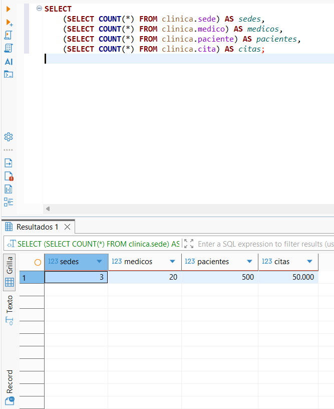
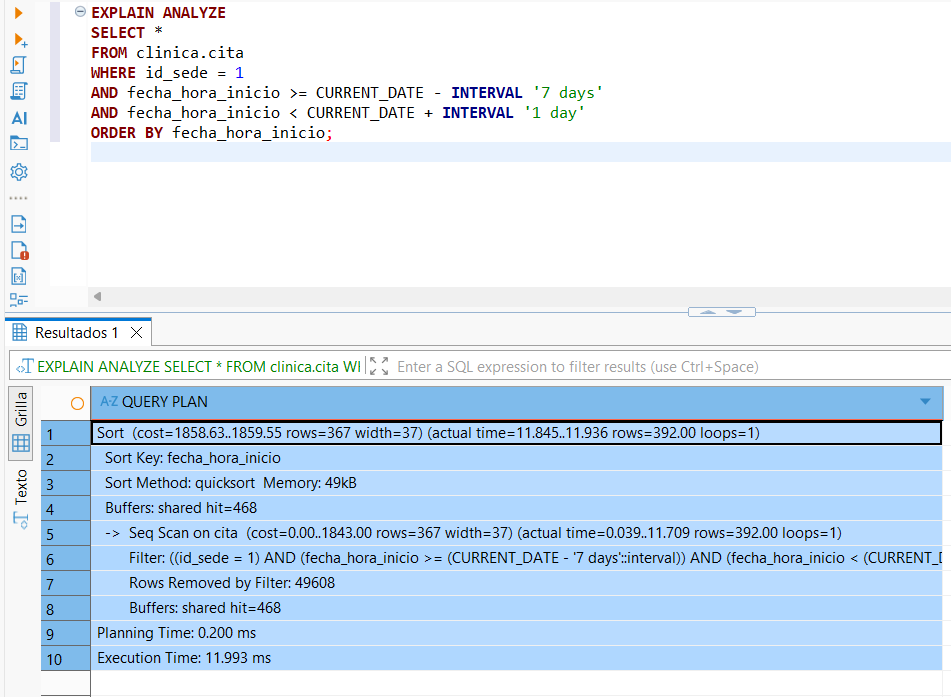
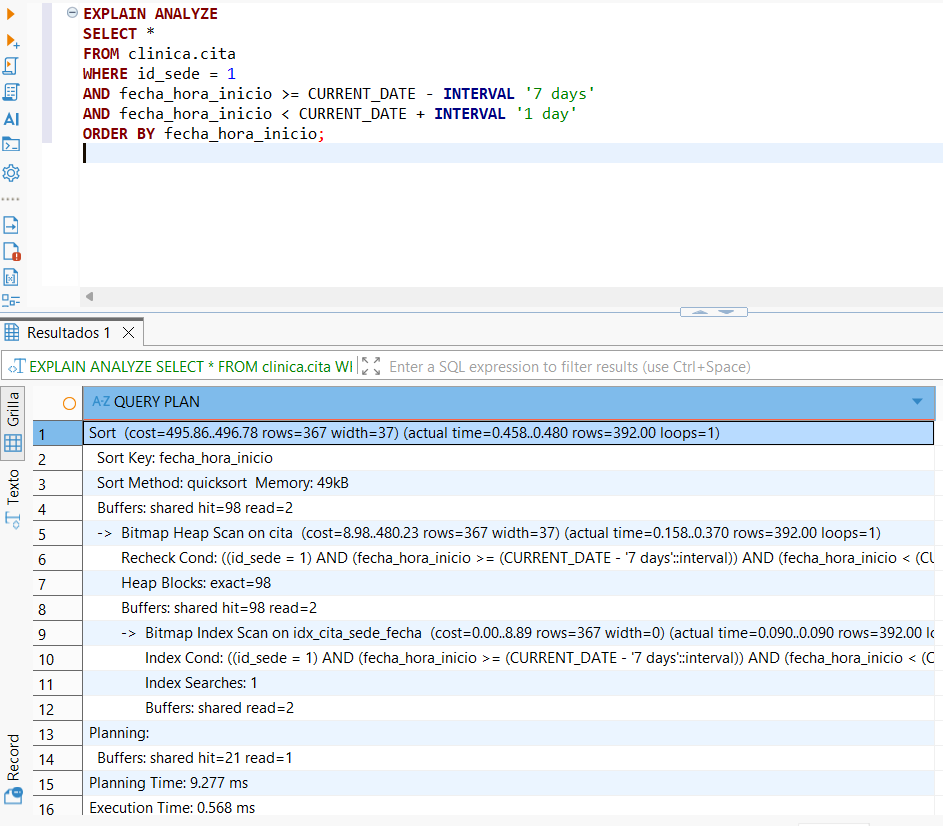

# Análisis de Rendimiento - Clínica Vida Plena

## 1. Volumetría de Datos
Para las pruebas de la base de datos se generaron datos ficticios utilizando la función `generate_series()` de PostgreSQL, cumpliendo con las cantidades solicitadas:

* 3 sedes.
* 20 médicos.
* 500 pacientes.
* 50,000 citas.

Los datos incluyen diferentes estados de citas, pacientes con y sin aseguradora, distintas especialidades y fechas.

---

## 2. Creación de Vistas
Se crearon tres vistas con la finalidad de facilitar las consultas dentro de la base de datos:

* `vista_agenda`: Permite consultar las citas junto con los datos del paciente, médico, especialidad y sede.
* `vista_inventario`: Muestra los medicamentos, existencias y fechas de vencimiento de los lotes.
* `vista_facturas`: Permite consultar los montos, saldos pendientes y estados de las facturas.

---

## 3. Implementación de Índices
Se crearon índices en las columnas que se utilizan frecuentemente en las búsquedas y relaciones entre tablas:

* `idx_cita_sede_fecha`
* `idx_cita_paciente_fecha`
* `idx_cita_medico_fecha`
* `idx_cita_especialidad_fecha`
* `idx_lote_sede_vencimiento`
* `idx_factura_consulta`
* `idx_detalle_medicamento`

---

## 4. Pruebas de Rendimiento
Se utilizó `EXPLAIN ANALYZE` para comparar el tiempo de ejecución de una consulta de citas por sede y fecha, antes y después de crear el índice correspondiente.

### Antes de aplicar el índice
PostgreSQL realizó una búsqueda secuencial (Seq Scan), recorriendo los 50,000 registros de la tabla cita.

* Tiempo de ejecución: 11.993 ms.
* Registros encontrados: 392.
* Registros descartados: 49,608.

### Después de aplicar el índice
Se creó el índice `idx_cita_sede_fecha` y se volvió a ejecutar la misma consulta. PostgreSQL utilizó Bitmap Index Scan y Bitmap Heap Scan.

* Tiempo de ejecución: 0.568 ms.
* Registros encontrados: 392.

---

## 5. Comparación de Resultados

| Característica | Antes | Después |
|---|---|---|
| Tiempo de ejecución | 11.993 ms | 0.568 ms |
| Método de búsqueda | Seq Scan | Bitmap Index Scan |
| Registros encontrados | 392 | 392 |

Se obtuvo una reducción aproximada del 95.26% en el tiempo de ejecución de la consulta realizada.

---

## 6. Conclusión
Con las pruebas realizadas se pudo observar que el uso de índices mejora el rendimiento de las consultas cuando se trabaja con grandes cantidades de datos. En este caso, se redujo el tiempo de ejecución sin afectar los resultados de la consulta. Los tiempos pueden variar dependiendo del equipo y las condiciones de ejecución.
